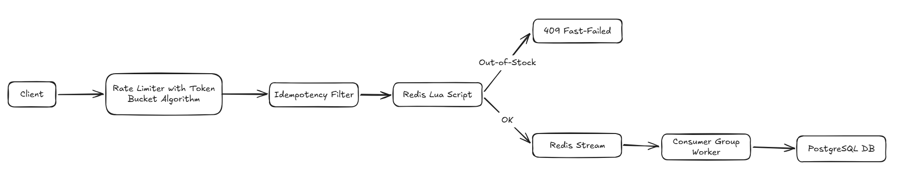
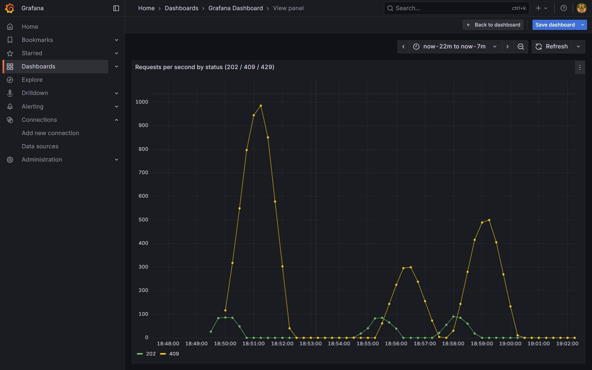
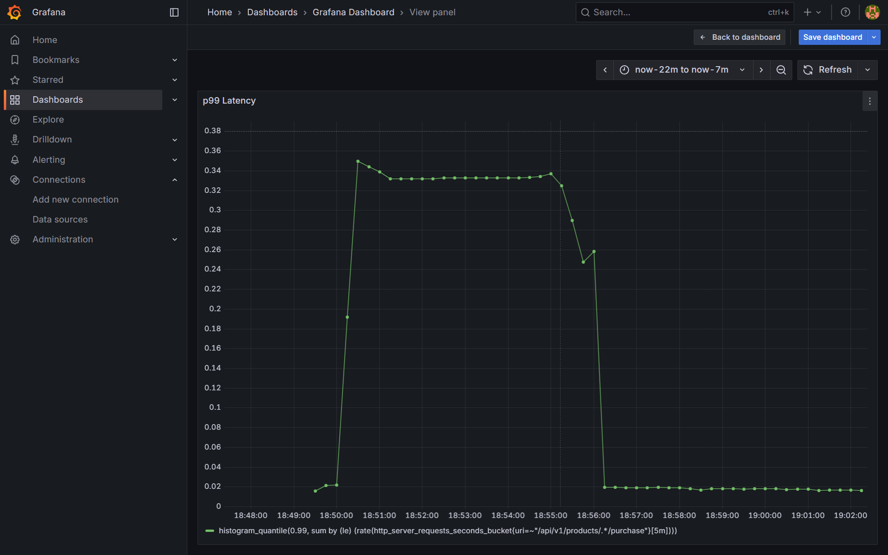
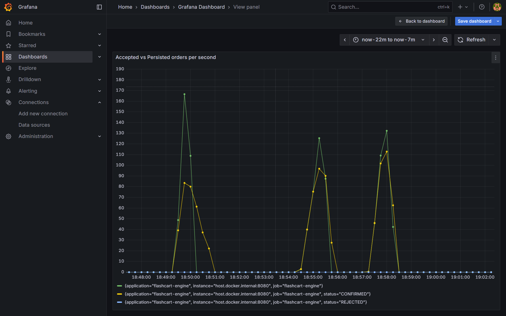
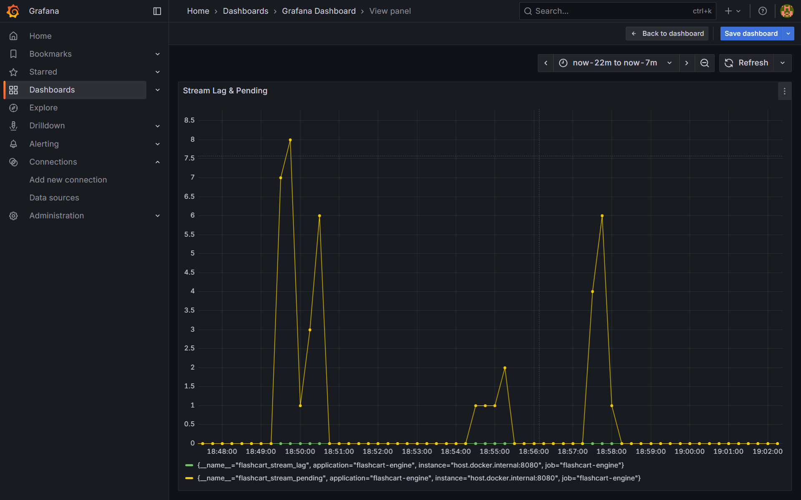
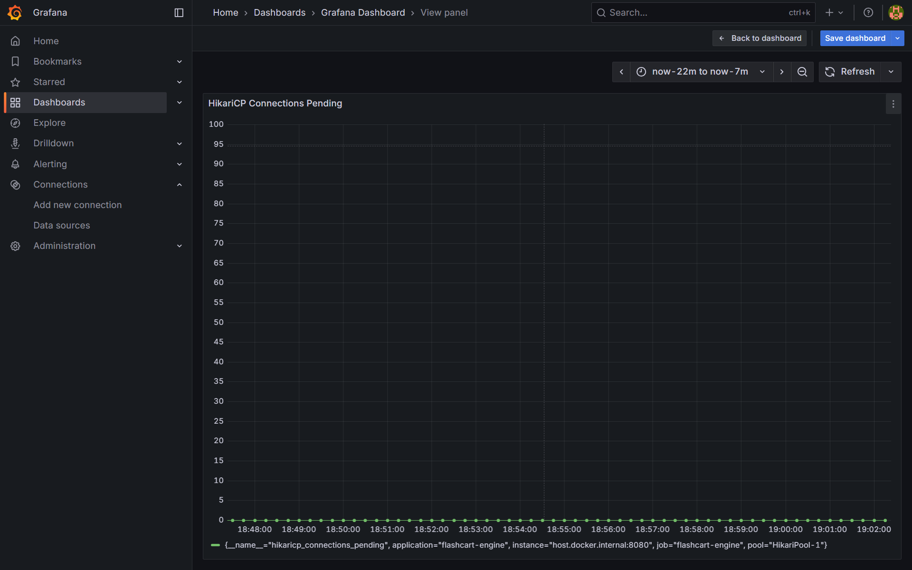
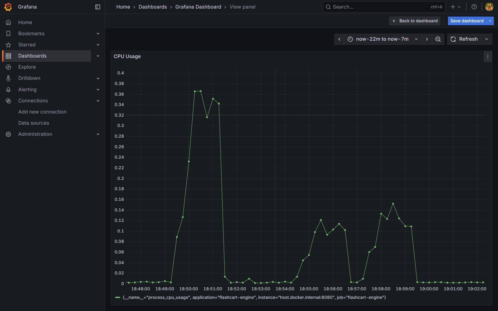
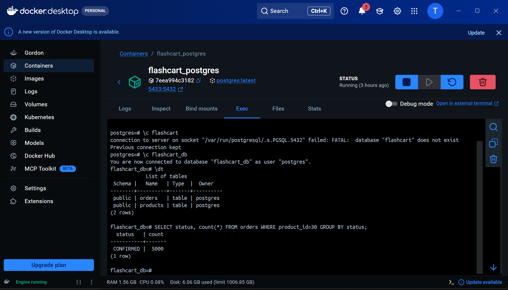
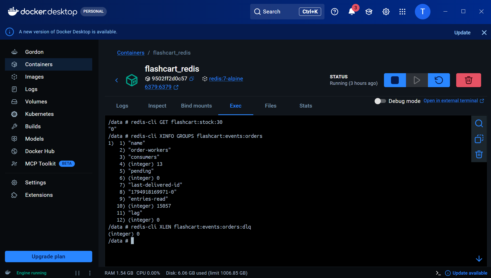
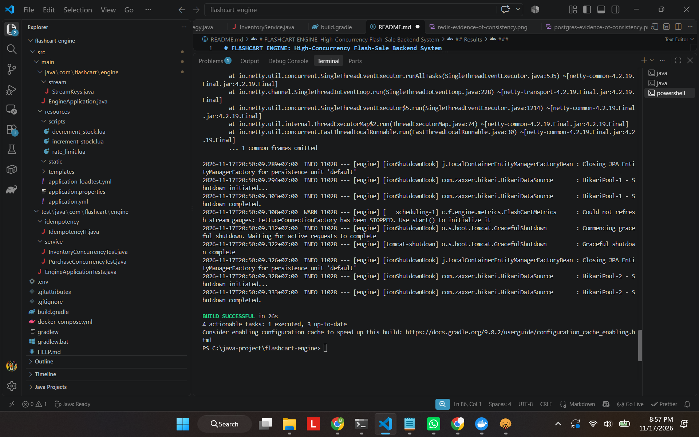

# FLASHCART ENGINE: High-Concurrency Flash-Sale Backend System

This is the backend system I build that can handle up to 1000 req/s with 0 oversold with Java SpringBoot, PostgreSQL Database, Redis Cache, and other Tech Stack to improve the performance and reliability of the system.

## Architecture Diagram 

When a client initiates a flash sale purchase request, it flows through a robust, high-performance, and multi-layered pipeline designed to reject bad traffic early and decouple heavy database operations



## Request Flow

1. **Rate Limiter (Token Bucket Algorithm)**
   * Acts as the first line of defense at the edge/interceptor level.
   * Protects the infrastructure from DDoS attacks and aggressive scripts by limiting requests per IP/user.
   * Instantly short-circuits excessive traffic with a `429 Too Many Requests` status.

2. **Idempotency Filter**
   * Validates the custom `Idempotency-Key` header.
   * Prevents accidental double-submissions or network-retry duplicates by caching responses in Redis.

3. **Redis Lua Script (In-Memory Fast-Fail)**
   * Atomically checks and pre-decrements product stock directly in Redis RAM.
   * **Out-of-Stock Scenario:** If inventory is depleted, it immediately short-circuits and responds with a `409` (or `429`) error in ~2ms without ever touching the primary database.
   * **Success Scenario (`OK`):** Passes the validated checkout payload downstream.

4. **Redis Stream & Consumer Group Worker**
   * Instead of synchronous database writes, successful purchase events are pushed to a **Redis Stream**. 
   * Background **Consumer Group Workers** consume these messages asynchronously, smoothing out traffic spikes.

5. **PostgreSQL DB**
   * Finalizes the order persistence and transactional state safely in the relational database, completely isolated from direct high-concurrency HTTP traffic pressure.


## Key Design

1. Redis Lua Script for Atomic Stock Pre-Decrement
* **The Problem:** Performing a separate `GET` (check stock) followed by a `DECR` (deduct stock) from Java creates a classic race condition—hundreds of concurrent threads can read `stock = 1` simultaneously and oversell.
* **The Decision:** Encapsulated the check-and-decrement logic inside a single **Redis Lua script**. Because Redis executes Lua scripts atomically on a single thread without interruption, inventory checks and deductions happen as one indivisible operation in sub-millisecond time.

2. PostgreSQL as the Source of Truth (Eventual Consistency)
* **The Problem:** Relying purely on an in-memory cache for order records risks data loss during a node crash, while hitting PostgreSQL synchronously on every request causes connection pool exhaustion (`HikariCP` saturation) under flash sale spikes.
* **The Decision:** Redis acts strictly as a high-speed **admission control & buffering layer**, while **PostgreSQL remains the durable Source of Truth**. Once pre-approved in Redis, order events are decoupled via Redis Streams and persisted asynchronously into PostgreSQL with database-level constraints and optimistic locking.

3. `XACK`-After-Commit (At-Least-Once Delivery)
* **The Problem:** If a background worker acknowledges (`XACK`) a message from Redis Streams *before* saving the order to PostgreSQL and then crashes, that paid/accepted order is permanently lost.
* **The Decision:** The consumer worker strictly executes `XACK` **only after the PostgreSQL transaction successfully commits**. Combined with idempotent order insertion (`orderId` / `idempotencyKey` uniqueness constraint in Postgres), if a worker crashes mid-flight, the Pending Entries List (PEL) recovery job safely reclaims and retries the message without creating duplicate orders.

4. Dead Letter Queue (DLQ) & Pending Message Recovery
* **The Problem:** Poison-pill messages (e.g., malformed payloads or unexpected constraint violations) can trap a consumer in an infinite retry loop, stalling the entire order processing pipeline.
* **The Decision:** Implemented a scheduled recovery mechanism (`XAUTOCLAIM` / `XPENDING`) that tracks delivery retry counts. Messages that remain unacknowledged past a threshold or exceed max retries are routed to a dedicated **Dead Letter Queue (`flashcart:events:orders:dlq`)** and acknowledged on the main stream—preventing pipeline blockage while preserving failed events for inspection.

5. Delta-Based Stock Increases (Postgres first, Redis second)
* **The Problem:** During an active flash sale, PostgreSQL lags slightly behind Redis due to asynchronous stream processing. If an admin restocks an item by overwriting Redis with the current PostgreSQL stock count, in-flight orders sitting in the stream would be wiped out, leading to overselling.
* **The Decision:** Admin restocks follow a strict **Postgres-First, Delta-Second** protocol:
  1. Atomically increment stock in PostgreSQL (`SET stock = stock + :qty`) and commit the transaction first.
  2. Apply the exact same **delta** (`INCRBY`) to Redis via Lua script (falling back to a DB warm-up only if the Redis key expired). If Redis fails after DB commit, the system safely *under-sells* rather than *oversells*.

## Results

### Grafana Dashboard

* Requests per second by Status (202/409/429)

* p99 Latency

* Accepted vs Persisted orders per second

* Stream Lag & Pending

* HikariCP Connections Pending

* CPU Usage



### Redis & Postgres Evidence of Consistency

* POSTGRESQL


* REDIS


### Gradle Test Execution

The system passed 4 tests which consists Idempotency, Inventory Concurrency, Purchase Concurrency, and Engine Application as shown in the images.



### Grafana Dashboard JSON

Link: `https://drive.google.com/file/d/1IpRWMZKGRY_g7TBQbOVT6U_fUDRUWbFx/view?usp=sharing`

## Trade-offs and Known limits

Every engineering architecture involves trade-offs between performances, consistency, and complexity as well as this Flashcart Backend System.

1. Eventual Consistency Between Redis and Postgres
* **The Trade-off:** To protect PostgreSQL from connection pool exhaustion during traffic spikes, Redis handles the high-speed inventory validation layer, while background workers update PostgreSQL asynchronously via Redis Streams.
* **The Impact:** For a brief window, the absolute stock count in PostgreSQL will lag behind Redis. Real-time dashboards querying PostgreSQL directly may show slightly higher stock numbers than what is currently active in the Redis cache.

2. The Crash Window (Decrement-to-Publish Gap)
* **The Trade-off:** The purchase flow executes a Redis Lua script to decrement stock in-memory, followed immediately by publishing an event to a Redis Stream. 
* **The Impact:** Because this is not an atomic distributed transaction (which would severely hurt throughput), there is an infinitesimal micro-window where if the JVM crashes *after* the Redis decrement succeeds *before* the stream write completes, a unit of stock is consumed without a corresponding order event (resulting in minor "ghost inventory" that is cleaned up during periodic reconciliation).

3. Idempotency Key Scope (No Payload Fingerprinting)
* **The Trade-off:** The idempotency mechanism indexes requests purely by the custom `Idempotency-Key` HTTP header, rather than computing a cryptographic hash (e.g., SHA-256) of the entire JSON request body.
* **The Impact:** This avoids CPU-intensive hashing overhead on every request. However, if a client reuses the exact same `Idempotency-Key` with a *different* payload or product ID, the system will return the cached response of the *original* request rather than rejecting it as a bad payload.

4. Placeholder `X-User-Id` Authentication
* **The Trade-off:** User identity and rate-limiting scope currently rely on a custom mock header (`X-User-Id`) rather than a fully implemented OAuth2/JWT Spring Security filter chain.
* **The Impact:** This decouples core concurrency and inventory logic from auth overhead during local load testing (k6). In a true production deployment, this header must be stripped at the API Gateway/Ingress level and replaced with cryptographically verified token claims to prevent header spoofing.

## Performance Benchmark & Trademark Analysis

To validate the concurrency guarantees, throughput capacity, and failure behavior of `FlashCart-Engine`, load testing was conducted using **k6** against three distinct traffic profiles. 

1. Benchmark Results

| Run Profile | Peak Target RPS | p95 Latency | p99 Latency | Dropped Requests | Accepted Orders | Oversold Count | Errors |
| :--- | :--- | :--- | :--- | :--- | :--- | :--- | :--- |
| **Sustained** | 500 req/s (60s peak) | 9.8 ms | 17.7 ms | 0 | 5,000 / 5,000 | **0** | 0 |
| **Light** | 300 req/s | 11.6 ms | 20.0 ms | 0 | 5,000 / 5,000 | **0** | 0 |
| **Stress** | 1000 req/s | 692 ms | 750 ms | 14 | 5,000 / 5,000 | **0** | 0 |

* **Zero Overselling:** Across all runs—including the 1,000 req/s stress test—exactly 5,000 orders were processed with **0 oversells**, proving the effectiveness of the Redis Lua atomic check-and-decrement layer.


2. Saturation Analysis & Bottleneck Identification

During local execution on a single development machine, the system saturation point is observed around **~680 req/s**. 

* **Behavior Under Sustained Load (≤ 500 req/s):** The system operates comfortably within safe parameters. Sub-20ms $p99$ latencies are maintained because requests are resolved immediately in Redis RAM (~2ms) without locking PostgreSQL.
* **Behavior Under Stress Load (1,000 req/s):** When pushing past the 680 req/s threshold, latencies jump significantly ($p99$ reaches ~750ms) and minor request drops occur. This bottleneck is bounded by local hardware constraints (single-machine thread scheduling, context switching, and network loopback limits for concurrent Redis/Postgres/Spring Boot containers).


3. Next Steps & Scaling Optimizations
To push the throughput ceiling higher on distributed infrastructure, the following architectural enhancements would be introduced:
* **Pipeline Optimization:** Consolidate multiple Redis round-trips into a single monolithic Lua script (combining rate limiting, idempotency checks, and stock decrement into one atomic network call).
* **Horizontal Consumer Scaling:** Increase the number of background `Redis Stream` consumer group threads to drain message queues faster under massive spikes.
* **Web Container Tuning:** Increase Tomcat max threads and connection pool sizes, or migrate the reactive Netty stack (Spring WebFlux) for non-blocking I/O efficiency.


## How to Run

### Prerequisites
* **Java 21 LTS**
* **Docker & Docker Compose**
* **k6** (for running load tests)

### Start Infrastructure & Observability Stack
```docker compose up -d```

Verify that all containers are healthy and running:
```docker compose ps```

### Start the Spring Boot Application
```./gradlew bootRun``` <br>
**API Base URL**: http://localhost:8080/
**Prometheus Metrics Endpoint**: http://localhost:8080/actuator/prometheus

### Monitor Live Metrics in Grafana
1. Open Grafana in your Browser (https://localhost:3000/)
2. Log in using credential (user: admin / pass: 123)
3. Import the pre-configured dashboard JSON located at monitoring/grafana/dashboards/flashcart-dashboard.json (or connect to the Prometheus data source at http://prometheus:9090).

### Execute the k6 Load Tests
```k6 run -e STOCK=5000 -e PEAK_RPS=500 --summary-export=loadtest/summary.json loadtest/purchase.js``` <br>
Note: The script automatically seeds a test product with the specified STOCK, warms up Redis, and hammers /api/v1/products/{id}/purchase with unique Idempotency-Key headers.
